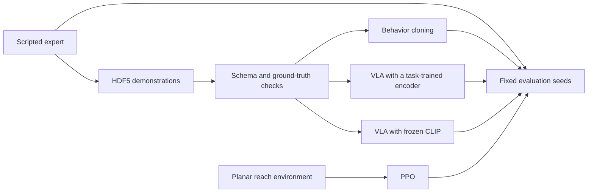
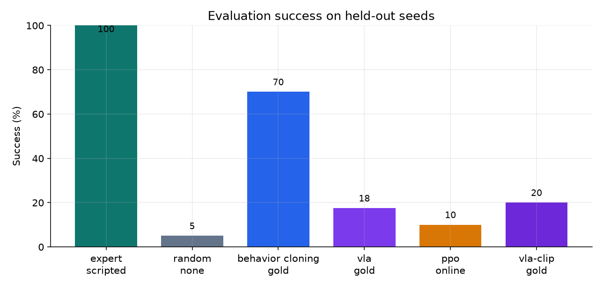
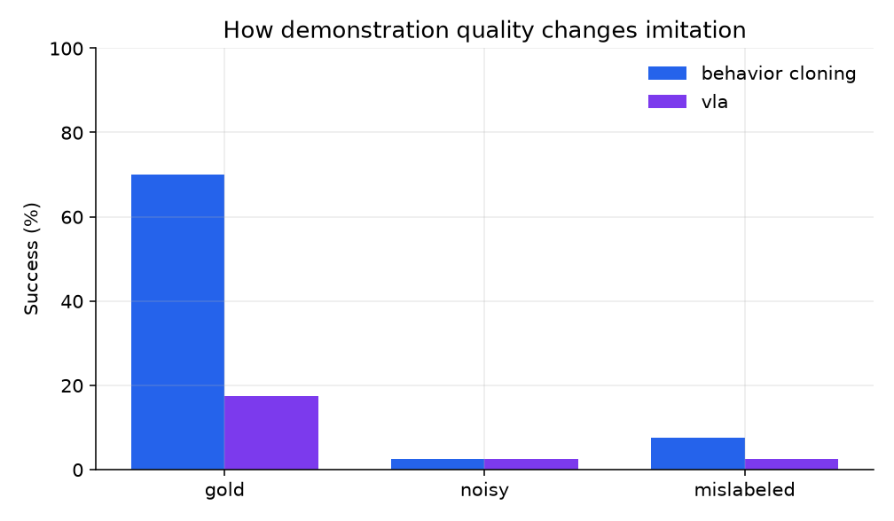
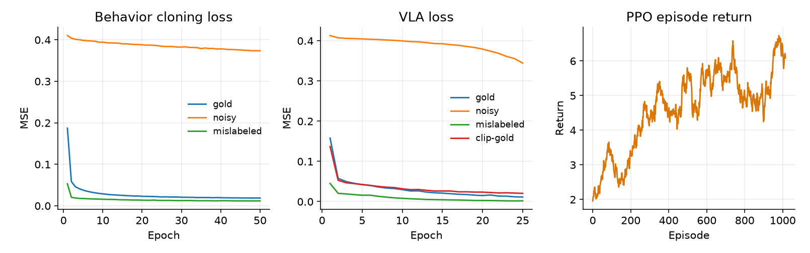
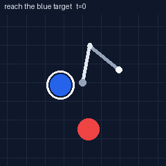
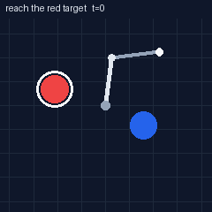

# SimReach

**Data-centric robot learning on a planar arm.**  
Arpan Bom · [applycoding@gmail.com](mailto:applycoding@gmail.com)

[](https://github.com/applycoding/robot-learning-vla-demo/actions/workflows/ci.yml)

SimReach is a small, CPU-only robot learning demo. A 2-link arm reaches a red or blue marker named by a language instruction. A scripted expert records demonstrations, a validator checks them against kinematic ground truth, and the same held-out seeds compare behavior cloning, PPO, and two vision-language-action policies.

The checked-in numbers below come from one run of `python -m simreach benchmark --out results --with-clip` (seed 0, 40 evaluation episodes). Regenerating the table takes a few minutes on CPU.

## Architecture



Behavior cloning and PPO observe a privileged state: joint features, end-effector position, the offset to the instructed target, and an instruction one-hot. Target coordinates stay in that state. Vision-language policies observe a top-down image, joint proprioception, and the instruction. Training frames show the arm and the two markers. The ring and the caption appear only on the GIFs.

## Quickstart

```bash
pip install torch --index-url https://download.pytorch.org/whl/cpu
pip install -e ".[dev]"
pytest
python -m simreach benchmark --out results --with-clip
```

`--with-clip` downloads `openai/clip-vit-base-patch32` once and trains an action head on frozen image and text embeddings. Omit the flag to skip that row.

Other entry points:

```bash
python -m simreach generate --out data/reach_demos.h5 --gold 200 --noisy 80 --mislabeled 80
python -m simreach validate data/reach_demos.h5 --report results/validation.json
python -m simreach train-bc --data data/reach_demos.h5 --quality gold --out results/checkpoints/bc_gold.pt
python -m simreach train-vla --data data/reach_demos.h5 --encoder tiny --out results/checkpoints/vla_gold.pt
python -m simreach train-vla --data data/reach_demos.h5 --encoder clip --out results/checkpoints/vla_clip_gold.pt
python -m simreach train-ppo --timesteps 49152 --out results/checkpoints/ppo
python -m simreach evaluate --expert --bc results/checkpoints/bc_gold.pt --episodes 40
```

Docker runs the short smoke benchmark:

```bash
docker build -t simreach .
docker run --rm simreach
```

## Task

The arm is velocity-controlled in the plane. Link lengths are 1 m, the time step is 0.1 s, and an episode lasts at most 50 steps. Two markers are sampled in the reachable annulus. The instruction is either `reach the red target` or `reach the blue target`. An episode succeeds when the end effector comes within 0.12 m of the instructed marker.

The action is a normalized joint-velocity command in `[-1, 1]`. The reward is `exp(-3 * distance)` plus 5 when the success ball is reached. The scripted expert is damped least-squares inverse kinematics toward the selected marker.

## Dataset

Demonstrations are an HDF5 file plus `meta/info.json`. Feature names follow the LeRobot convention (`observation.state`, `observation.image`, `observation.language`, `action`); the bytes live in HDF5. The full schema, integrator, reward, and tier rules are in [docs/DATASET_SPEC.md](docs/DATASET_SPEC.md).

| Tier | What the expert does | Episodes in the reported run | Demos that reach the instructed target |
| --- | --- | ---: | ---: |
| gold | Tracks the instructed color | 200 | 100% |
| noisy | Same target, with random and shrunk actions | 80 | 21% |
| mislabeled | Language names one color; the controller tracks the other | 80 | 2.5% |

The validator recomputes joint updates, rewards, and success from the stored angles. On this dataset it accepted all 10,673 transitions (max kinematic error about `5e-7`) and all 200 gold episodes. It flagged 2 mislabeled episodes whose swing still touched the instructed marker.

## Results

Evaluation uses seeds `0..39` for every method. Success means the end effector entered the 0.12 m ball. Final distance is the distance at the last step.

| Method | Data | Success | Mean return | Mean final distance |
| --- | --- | ---: | ---: | ---: |
| expert | scripted | 100.0% | 8.67 | 0.105 |
| behavior cloning | gold | 70.0% | 11.97 | 0.159 |
| behavior cloning | noisy | 2.5% | 3.85 | 1.213 |
| behavior cloning | mislabeled | 7.5% | 2.46 | 1.627 |
| vla | gold | 17.5% | 4.68 | 1.010 |
| vla | noisy | 2.5% | 1.43 | 1.607 |
| vla | mislabeled | 2.5% | 3.02 | 1.381 |
| vla-clip | gold | 20.0% | 4.05 | 1.142 |
| ppo | online | 10.0% | 8.00 | 0.780 |
| random | none | 5.0% | 1.33 | 1.801 |

Success rate and final distance are the comparison metrics. Return sums the dense approach bonus over every step of the episode, so a long near-miss can collect more return than a short success. That is why behavior cloning on gold reports a higher mean return than the expert while finishing slightly farther away.

Clean demonstrations carry the imitation result: behavior cloning on gold reaches 70%, and the same algorithm on noisy or mislabeled data falls to 2.5% and 7.5%. The vision-language policies, which have to find the named marker in the image, land near 20% with either a task-trained convolutional encoder or a frozen CLIP ViT-B/32 backbone and a trained action head. PPO, trained online for 49,152 steps from the privileged state, moves the arm closer than a random policy (0.78 m versus 1.80 m) and succeeds on 10% of seeds. Its learning curve is still rising at this budget.







Expert and behavior-cloning rollouts on a successful evaluation seed. The white ring and the caption are figure-only; training images omit them.





## Layout

```
simreach/           environment, expert, dataset, training, evaluation
docs/DATASET_SPEC.md
tests/              kinematics, dataset audit, learning smoke tests, quick benchmark
results/            metrics, plots, and GIFs from the reported run
.github/workflows/ci.yml
Dockerfile
```

`pytest` covers the integrator, the expert, HDF5 round-trip, validator rejections, a behavior-cloning loss drop, the CLIP action head with a stub encoder, a short PPO update, and a tiny end-to-end benchmark. GitHub Actions runs that suite on Ubuntu with a CPU PyTorch wheel.

## License

MIT. Copyright 2026 Arpan Bom.
